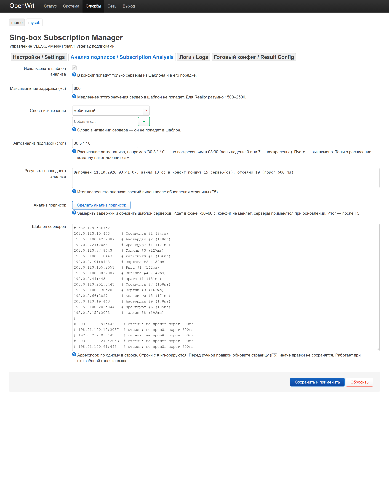

# luci-app-mysub (Sing-box Subscription Manager)

**luci-app-mysub** — это удобный плагин с веб-интерфейсом LuCI для маршрутизаторов на базе OpenWrt. Он предназначен для автоматизированного управления, парсингом и обновления подписок прокси-клиента **Sing-box** (VLESS, VMess, Trojan, Hysteria2).

Плагин автоматизирует процесс получения конфигураций от провайдеров, их декодирование и интеграцию в рабочую среду роутера с использованием метода маркеров (`{all_subs}`).



*Вкладка «Анализ подписок»: порог задержки, автоанализ по cron, замер и шаблон серверов. Данные на скриншоте обезличены — подписки, адреса серверов и задержки приведены для примера.*

## Требования
Для работы плагина требуются следующие зависимости (устанавливаются автоматически при штатной инсталляции пакета):
* `jq` (для парсинга и обработки JSON)
* `curl` (для загрузки подписок по сети)
* `coreutils-base64` (для декодирования Base64 ссылок)

## Быстрый старт

1. Установите пакет `luci-app-mysub`
2. Откройте шаблон и отредактируйте под свои нужды:
   ```sh
   vi /etc/mysub/template.json
   ```
3. В веб-интерфейсе LuCI перейдите в **Services → Sing-box Subscriptions**
4. Добавьте ссылки на подписки и укажите путь к шаблону
5. Нажмите **Run Update**

## Шаблон конфигурации (template.json)

Для корректной работы парсера необходимо создать файл шаблона `template.json`, в который плагин будет внедрять полученные из подписки узлы. Место вставки узлов в вашем JSON-шаблоне должно быть отмечено специальным массивом-маркером `{all_subs}`.

Пример шаблона установлен в `/etc/mysub/template.json`.

Маркер `{all_subs}` используется в двух местах:
- В `selector`-аутбаунде — для выбора прокси вручную
- В `urltest`-аутбаунде — для автоматического выбора сервера

```json
{
  "outbounds": [
    {
      "type": "selector",
      "tag": "proxy",
      "outbounds": ["auto", "direct", "{all_subs}"]
    },
    {
      "type": "urltest",
      "tag": "auto",
      "outbounds": ["{all_subs}"]
    }
  ]
}
```

Скрипт парсера автоматически найдёт `{all_subs}` и заменит его на список серверов из ваших подписок.

## Анализ подписок и шаблон серверов (опционально)

По умолчанию парсер работает как раньше — в конфиг попадают **все** найденные серверы.
Дополнительно есть вкладка **Анализ подписок**: она позволяет держать в конфиге только
быстрые серверы и ровно в нужном порядке.

**Как это работает**

1. На вкладке «Анализ подписок» нажмите **Сделать анализ подписок**.
2. Парсер скачает подписки, отбросит серверы по словам-исключениям, замерит **реальную
   задержку** каждого сервера и запишет в поле «Шаблон серверов» только те, что уложились
   в `max_delay_ms`, отсортировав их по возрастанию задержки.
3. Включите галочку **Использовать шаблон анализа** и сохраните настройки. С этого момента
   каждое обновление (в том числе по cron) добавляет в конфиг только серверы из шаблона
   и в том порядке, в котором они записаны.

**Как измеряется задержка.** Не ICMP и не TCP-connect: ICMP часто режется файрволами
хостеров, а любое TCP-соединение изнутри роутера перехватывается tproxy (momo) и измеряется
некорректно. Поэтому парсер поднимает **отдельный временный экземпляр sing-box** с Clash API
на localhost, прогоняет через него реальные подключения, и гасит его. Рабочий сервис, его
конфиг и текущее соединение при анализе не затрагиваются.

**Формат шаблона.** Одна строка — один сервер в виде `адрес:порт`; всё после `#` считается
комментарием. Привязка идёт к адресу и порту, а не к названию, поэтому шаблон не ломается,
когда провайдер меняет состав подписки или порядок серверов.

```
203.0.113.10:443   # Швеция (111ms)
198.51.100.7:8443  # Хельсинки (136ms)
```

**Защита от потери связи:**

* если анализ не нашёл ни одного сервера быстрее порога — шаблон не перезаписывается;
* если галочка включена, а шаблон пуст или ни один сервер из него не найден в подписке —
  обновление отменяется, рабочий конфиг остаётся нетронутым, причина пишется в лог.

**Автоматический анализ по расписанию.** Чтобы шаблон не устаревал, в поле
**Автоанализ подписок (cron)** задаётся обычное cron-выражение — день и время выбираете сами:

```
30 3 * * 0     # каждое воскресенье в 03:30
15 5 * * 1,4   # по понедельникам и четвергам в 05:15
```

При срабатывании запускается `mysub-update.sh --analyze`: обновляется только шаблон серверов,
рабочий конфиг не затрагивается. Пустое поле выключает автоанализ, а сохранение настроек
пересобирает строки crontab начисто — дублей не остаётся. Разумно ставить анализ раньше обычного
обновления (по умолчанию `0 4 * * *`), тогда свежий шаблон применится в тот же день. Расписание
правьте в LuCI, а не в crontab руками: при сохранении настроек строка пересобирается.

**Ограничения:** слова-исключения на русском учитывают регистр (ограничение BusyBox,
для латиницы регистр не важен); группы стран из Xray-JSON подписок не участвуют в замере,
поэтому при включённом шаблоне в конфиг не попадают.

## Поддерживаемые протоколы
* VLESS (включая Reality и XTLS)
* VMess (WebSocket, gRPC)
* Trojan (TLS, WebSocket)
* Hysteria2 (с obfs)

## Конфигурация

| Параметр | По умолчанию | Описание |
|---|---|---|
| `urls` | — | Ссылки на подписки (v2rayN, Base64) |
| `base_config` | `/etc/mysub/template.json` | Путь к базовому шаблону |
| `output_config` | `/etc/mysub/mysub.json` | Куда сохранить результат |
| `cron` | `0 4 * * *` | Расписание автообновления |
| `log_level` | `info` | Уровень логирования (info/debug) |
| `use_analysis_template` | `0` | Использовать шаблон анализа при обновлении |
| `max_delay_ms` | `500` | Порог реальной задержки (мс) для анализа |
| `exclude_keywords` | — | Слова-исключения для анализа (UCI list) |
| `server_template` | — | Шаблон серверов `адрес:порт` (генерируется кнопкой анализа) |
| `analysis_cron` | — | Расписание автоанализа подписок (обычный cron; пусто — выключен) |

## Отказ от ответственности

Этот инструмент предназначен только для личного использования.
Пожалуйста, не используйте его для каких-либо незаконных действий и соблюдайте правила вашей страны.
Разработчики не несут ответственности за любые нарушения условий использования, установленных вашим округом.

## Сборка

```sh
# В дереве исходников OpenWrt
make package/luci-app-mysub/compile V=s
```
